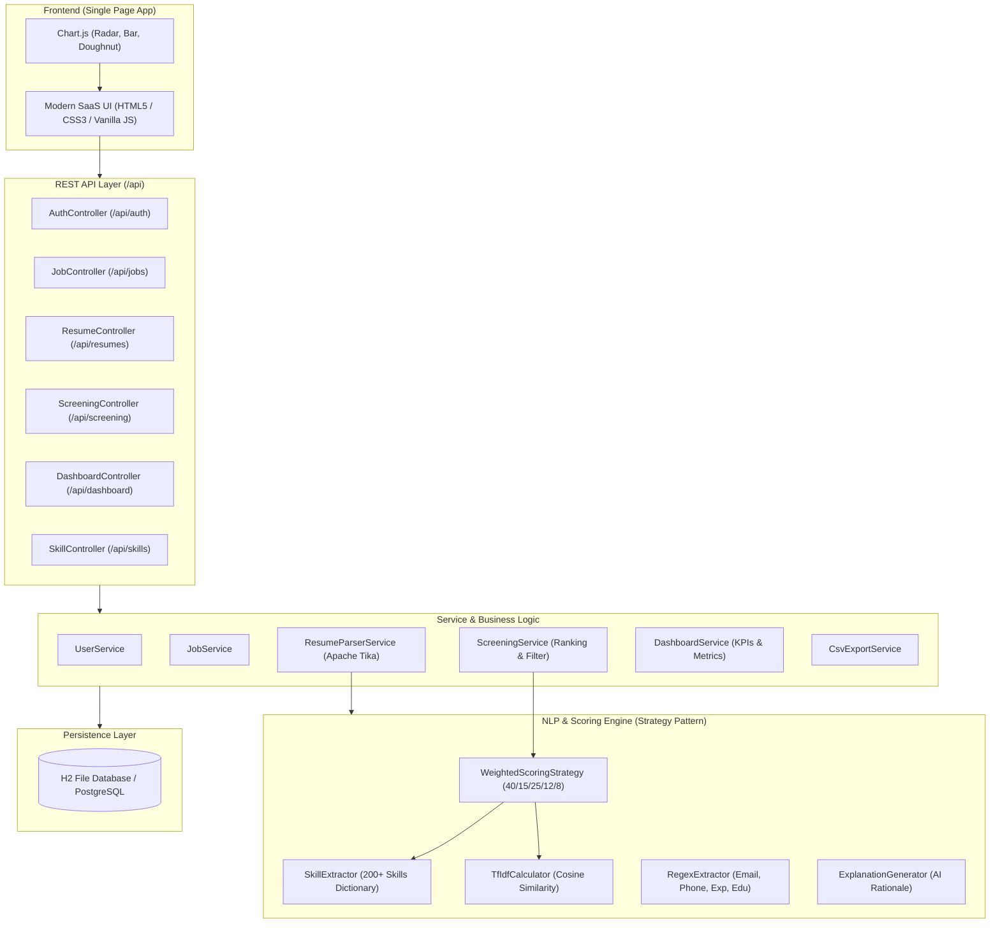
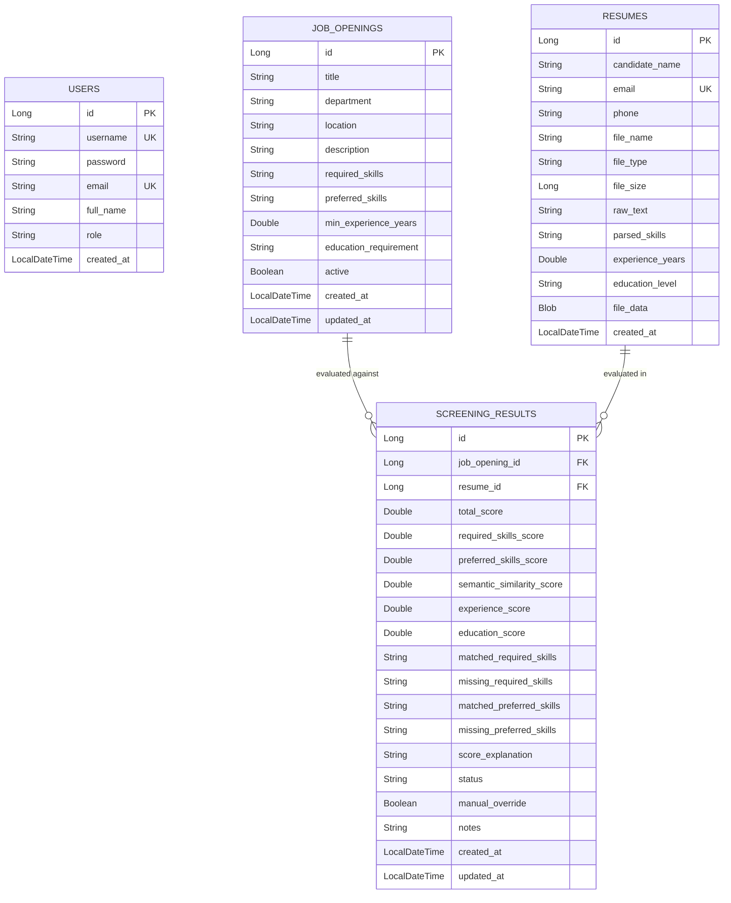

# Smart Resume Screening System

An enterprise-grade, automated **Smart Resume Screening System** built with **Java 17**, **Spring Boot 3.x**, **Apache Tika**, and **NLP Algorithms** (Curated Skills Dictionary, TF-IDF Cosine Similarity, and Regex Extractors).

---

## 📌 Project Overview

Recruiting and HR teams face hundreds of incoming resumes in varied formats (PDF, DOCX, DOC, TXT). Manually reading, parsing, and ranking applicants against job requirements is time-consuming and error-prone.

The **Smart Resume Screening System** provides an end-to-end automated solution:
1. **Multi-Format Resume Ingestion**: Upload individual or bulk resumes with drag-and-drop support.
2. **Text Extraction via Apache Tika**: Robust text parsing from PDF and DOCX files.
3. **Pure Java NLP & Entity Extraction**:
   - Skill extraction using a **curated dictionary of 200+ technology and domain skills** with synonym resolution (e.g., `k8s` → `Kubernetes`, `js` → `JavaScript`, `reactjs` → `React`).
   - Regex-based extraction of candidate contact info (Email, Phone), total years of experience, and highest education level.
   - Text semantic relevance computation using **TF-IDF + Cosine Similarity**.
4. **Weighted Composite Scoring Engine (out of 100)**:
   - **40%** Required Skills Match
   - **15%** Preferred Skills Match
   - **25%** Semantic Text Similarity (TF-IDF Cosine)
   - **12%** Experience Fit
   - **8%** Education Fit
5. **Interactive SaaS Dashboard & Screening UI**:
   - Ranked candidate tables with circular match gauges and filter/sort controls.
   - Candidate detail modal with 5-component score breakdown, radar chart, and natural language explanation.
   - Side-by-side comparison of 2 to 4 candidates with comparative radar and bar charts.
   - One-click CSV export of shortlisted candidates.

---

## 🛠️ Tech Stack

| Layer | Technology | Purpose |
| :--- | :--- | :--- |
| **Backend** | Java 17, Spring Boot 3.3.5 | Core framework, RESTful APIs, Service layer |
| **Security** | Spring Security 6 (BCrypt) | Authentication, session, and role security |
| **Persistence** | Spring Data JPA, Hibernate | Data layer, repositories, ORM mapping |
| **Databases** | H2 (File-based default) / PostgreSQL | Embedded zero-config DB with easy switch to Postgres |
| **Document Parser** | Apache Tika 2.9.2, PDFBox, POI | Extracting structured text from PDF/DOCX |
| **NLP & Scoring** | Pure Java TF-IDF, Regex, Dictionary | 100% offline, zero paid API dependency |
| **API Docs** | Springdoc OpenAPI (Swagger UI) | Interactive REST API documentation |
| **Frontend** | Vanilla JS, HTML5, CSS3, Chart.js | Modern SaaS dashboard, responsive, SPA |
| **Testing** | JUnit 5, Mockito | Comprehensive unit and integration test suite |

---

## 🏛️ System Architecture

### 1. Layered Architecture Diagram



---

## 🗄️ Entity-Relationship (ER) Diagram



---

## 🧮 Scoring Engine & Mathematical Formulation

The final candidate match score $S_{\text{total}} \in [0, 100]$ is computed as:

$$S_{\text{total}} = \frac{w_{\text{req}} \cdot S_{\text{req}} + w_{\text{pref}} \cdot S_{\text{pref}} + w_{\text{sem}} \cdot S_{\text{sem}} + w_{\text{exp}} \cdot S_{\text{exp}} + w_{\text{edu}} \cdot S_{\text{edu}}}{w_{\text{req}} + w_{\text{pref}} + w_{\text{sem}} + w_{\text{exp}} + w_{\text{edu}}}$$

Default configurable weights in `application.properties`:
- $w_{\text{req}} = 40.0\%$ (Required Skills Match)
- $w_{\text{pref}} = 15.0\%$ (Preferred Skills Match)
- $w_{\text{sem}} = 25.0\%$ (Semantic Text Cosine Similarity)
- $w_{\text{exp}} = 12.0\%$ (Experience Fit)
- $w_{\text{edu}} = 8.0\%$ (Education Level Fit)

### 1. Skills Matching Component
$$S_{\text{req}} = \frac{|\text{CandidateSkills} \cap \text{RequiredSkills}|}{|\text{RequiredSkills}|} \times 100$$

### 2. Semantic Similarity (TF-IDF Cosine)
Given term vector $\mathbf{v}_{\text{resume}}$ and job vector $\mathbf{v}_{\text{job}}$:
$$\text{CosineSim} = \frac{\mathbf{v}_{\text{resume}} \cdot \mathbf{v}_{\text{job}}}{\|\mathbf{v}_{\text{resume}}\| \|\mathbf{v}_{\text{job}}\|}, \quad S_{\text{sem}} = \text{CosineSim} \times 100$$

### 3. Experience Fit Component
$$S_{\text{exp}} = \begin{cases} 
100.0 & \text{if } \text{Exp}_{\text{cand}} \ge \text{Exp}_{\text{req}} \\
\frac{\text{Exp}_{\text{cand}}}{\text{Exp}_{\text{req}}} \times 100 & \text{if } \text{Exp}_{\text{cand}} < \text{Exp}_{\text{req}}
\end{cases}$$

### 4. Candidate Status Auto-Tagging
- **`SHORTLISTED`**: Score $\ge 70.0\%$
- **`REVIEW`**: $45.0\% \le \text{Score} < 70.0\%$
- **`REJECTED`**: $\text{Score} < 45.0\%$

*(HR users can manually override any candidate's status and add customized notes at any time).*

---

## 🚀 Quick Setup & Run Guide

### Prerequisites
- **Java 17+** (JDK 17 or higher installed)
- **Maven** (A portable `mvnw.cmd` / `mvn.cmd` is included)

### 1. Run with a Single Command
In the project root directory, run:
```bash
mvn spring-boot:run
```
*(On Windows you can also use `.\mvnw.cmd spring-boot:run` or `.\mvn.cmd spring-boot:run`)*

### 2. Open Application in Browser
- **Web UI Dashboard**: [http://localhost:8080](http://localhost:8080)
- **Swagger / OpenAPI Documentation**: [http://localhost:8080/swagger-ui.html](http://localhost:8080/swagger-ui.html)
- **H2 Database Console**: [http://localhost:8080/h2-console](http://localhost:8080/h2-console)
  - JDBC URL: `jdbc:h2:file:./data/resumedb`
  - User: `sa`
  - Password: *(blank)*

### 3. Default Login Credentials
- **Username**: `admin`
- **Password**: `admin123`

---

## 📡 REST API Reference

| Method | Endpoint | Description |
| :--- | :--- | :--- |
| `POST` | `/api/auth/login` | HR Login authentication |
| `GET` | `/api/auth/me` | Current authenticated user profile |
| `GET` | `/api/jobs` | List all job openings with applicant metrics |
| `POST` | `/api/jobs` | Create a new job opening |
| `PUT` | `/api/jobs/{id}` | Update job opening requirements |
| `DELETE` | `/api/jobs/{id}` | Delete job opening |
| `POST` | `/api/resumes/upload` | Multi-file resume upload (PDF/DOCX) |
| `GET` | `/api/resumes/{id}/download` | Download original resume file |
| `GET` | `/api/screening/jobs/{jobId}` | Get ranked candidates with filters & sort |
| `GET` | `/api/screening/{id}` | Detailed candidate score breakdown & explanation |
| `PATCH` | `/api/screening/{id}/status` | Update candidate status (Shortlisted/Review/Rejected) |
| `POST` | `/api/screening/compare` | Compare 2 to 4 candidates side-by-side |
| `GET` | `/api/screening/jobs/{jobId}/export-csv` | Export shortlist to CSV spreadsheet |
| `GET` | `/api/dashboard/metrics` | Summary KPIs, score distribution & top skills |
| `GET` | `/api/skills` | List 200+ curated skills dictionary |

---

## 📂 Project Structure

```text
smart-resume-screening/
├── pom.xml
├── mvn.cmd / mvnw.cmd
├── README.md
├── samples/
│   ├── Resume_Alex_Morgan_Senior_Java.pdf
│   ├── Resume_Sarah_Chen_FullStack.docx
│   ├── Resume_David_Kumar_DataScientist.pdf
│   ├── Resume_Emily_Watson_Junior_Dev.docx
│   └── Resume_Michael_Ross_DevOps_Cloud.pdf
└── src/
    ├── main/
    │   ├── java/com/smartresume/
    │   │   ├── SmartResumeApplication.java
    │   │   ├── config/ (SecurityConfig, ScoringProperties, OpenApiConfig, DataInitializer)
    │   │   ├── controller/ (Auth, Job, Resume, Screening, Dashboard, Skill)
    │   │   ├── dto/ (Requests, Responses, ApiResponse)
    │   │   ├── exception/ (GlobalExceptionHandler, CustomExceptions)
    │   │   ├── model/ (JobOpening, Resume, ScreeningResult, User, Enums)
    │   │   ├── nlp/ (SkillExtractor, TextTokenizer, TfIdfCalculator, RegexExtractor)
    │   │   ├── repository/ (JpaRepositories)
    │   │   ├── service/ (Parser, Job, Screening, Dashboard, CsvExport, SampleGen)
    │   │   ├── strategy/ (ScoringStrategy, WeightedScoringStrategy, ExplanationGen)
    │   │   └── util/ (FileValidator, ModelMapperUtil)
    │   └── resources/
    │       ├── application.properties
    │       ├── skills_dictionary.json (200+ skills with synonyms)
    │       └── static/ (index.html, css/style.css, js/app.js)
    └── test/
        └── java/com/smartresume/
            ├── nlp/ (SkillExtractorTest, TfIdfCalculatorTest, RegexExtractorTest)
            ├── service/ (ResumeParserServiceTest, JobServiceTest)
            └── strategy/ (WeightedScoringStrategyTest)
```

---

## 🔮 Future Scope
- Integration with LinkedIn & Greenhouse / Lever ATS webhooks.
- Fine-tuned transformer embeddings (BERT/MiniLM) in addition to TF-IDF.
- Automated email dispatch to shortlisted or rejected candidates with customized feedback.
- AI interview question generator tailored to candidate's missing required skills.
